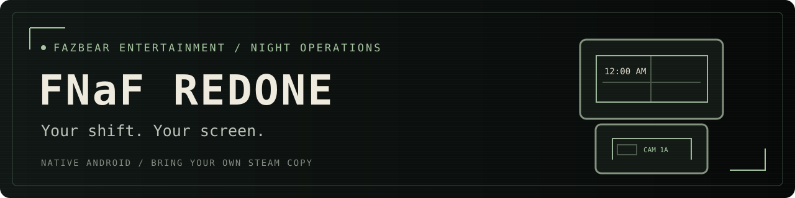
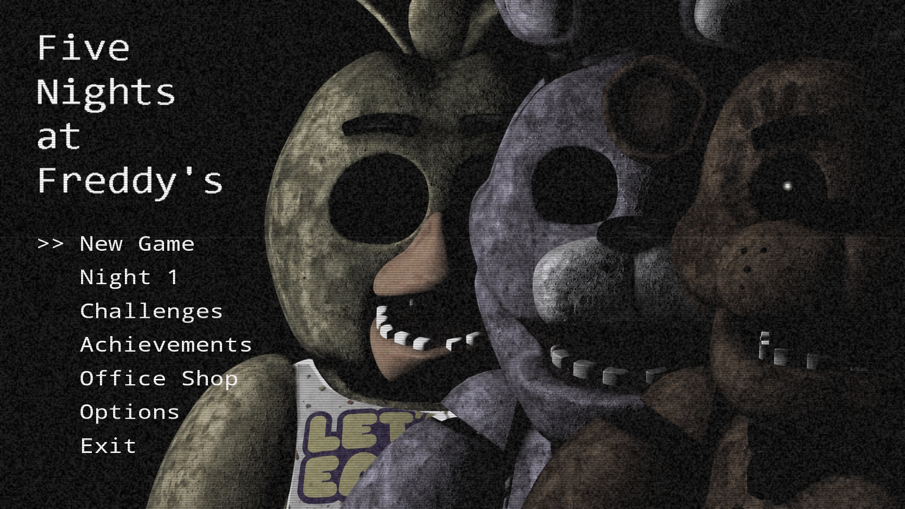
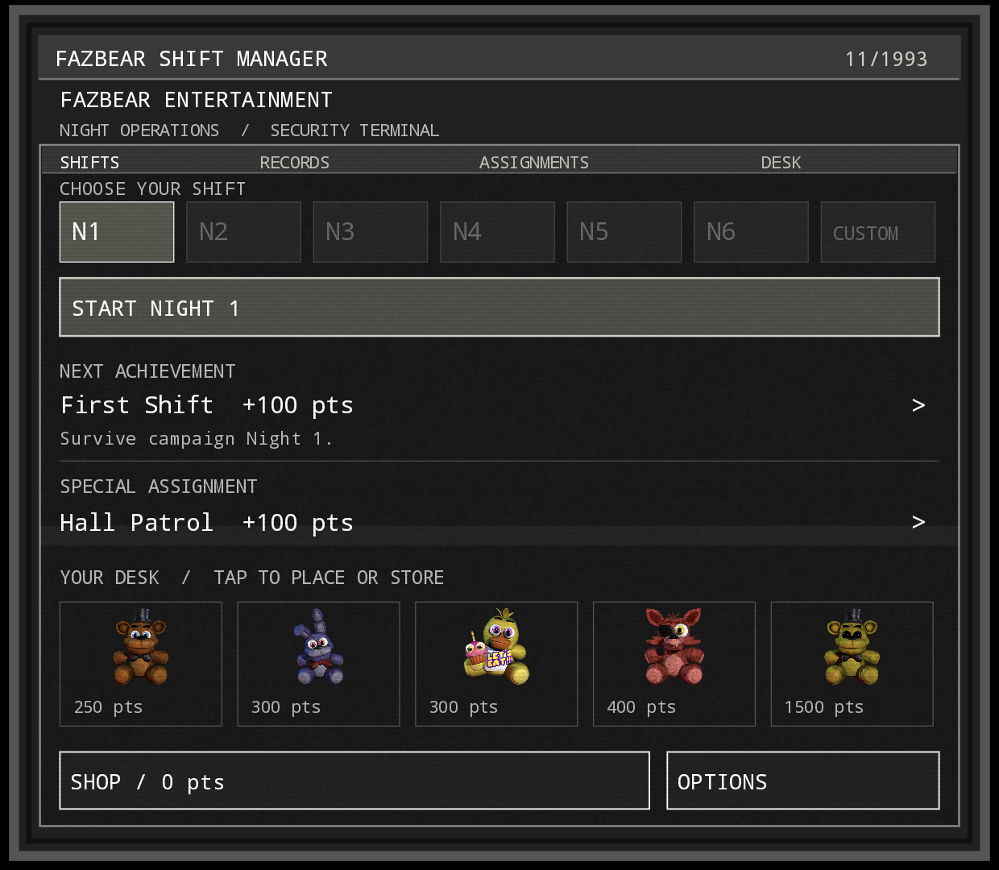

**An enhanced Five Nights at Freddy’s 1 port for Android handhelds.**

Single- and dual-screen support. Bring your own Steam copy. Windows x64 client also available.

### [Android APK](https://github.com/MjonirMade/fnaf-redone/releases/download/v0.1.3-preview/FNaF-Redone-0.1.3-preview.apk) · [Windows ZIP](https://github.com/MjonirMade/fnaf-redone/releases/tag/v0.2.4-windows-preview) · [Report a bug](https://github.com/MjonirMade/fnaf-redone/issues/new?template=bug_report.yml)

## Welcome to the night shift

The office belongs on the top screen. The cameras belong in your hands.
FNaF Redone pairs the familiar doors, lights, power management, and camera survival
loop with native controller support, a companion terminal, and unlockable office
cosmetics. On a single-screen device, the office and cameras fill the same display.

This fan-made Android port uses a standalone runtime that imports assets from your own
Steam installation. It runs locally and offline; it does not stream your PC or run
the original Windows game executable. The Windows client shares the Android
gameplay and menus, with native desktop rendering, audio, and controller input.

> **Preview release:** the gameplay is intended to preserve FNaF 1’s rules and
> difficulty. Cosmetics provide no gameplay advantages. This is a reconstructed
> runtime, so exact AI and timing parity with the original has not been fully
> verified. See [compatibility and testing](docs/COMPATIBILITY.md).

## What’s inside

| The night shift | Beyond the office |
| --- | --- |
| Dual-screen office and camera controls | Animated title lineup with CRT static and eye effects |
| Full-screen single-device mode | A November 1993 companion terminal |
| Controller and touch support | Achievements and challenges with weighted point rewards |
| Campaign, sixth night, and Custom Night | Five purchasable office plushies |
| Newspaper opening, night cards, and 6 AM celebration | Freddy, Bonnie, Chica, Foxy, and Golden Freddy cosmetics |
| Endings and title stars | Saved display preferences, button remapping, and look sensitivity |

<strong>See the companion terminal</strong>

Choose a shift, track achievements, check assignments, and arrange your desk.
Single-screen users can open the same information from **Options → Shift dashboard**.

## Get playing

**On Windows?** Download the portable x64 ZIP, extract the whole folder, and run
**FNaF Redone.exe**. Choose **New Game → Scan Steam** to find and import your
installed FNaF 1 copy automatically, or **Browse File** to select it yourself.
No separate Java installation is needed. [Windows setup and controls](desktop/README.md).

**On Android:**

**You need Android 8.0+, 1.5 GB free during setup, and your purchased Windows Steam
copy of FNaF 1.** Supports single- and dual-screen Android handhelds; see the
[compatibility notes](docs/COMPATIBILITY.md) for tested hardware.

1. [Download and install the APK](https://github.com/MjonirMade/fnaf-redone/releases/tag/v0.1.3-preview). It appears as **FNaF Redone**.
2. On your PC, open Steam → FNaF 1 → Manage → **Browse local files**.
3. Copy **FiveNightsatFreddys.exe** to your Android device’s Downloads folder.
4. Open the app → **New Game → Select Steam File**, and choose that file.
5. Wait for **Ready to play**, then start the game.

**No Steam sign-in or separate extractor needed.** The app extracts your game’s
images and sounds on the device. Only the verified Steam build is currently
supported; check the [file hash and requirements](docs/COMPATIBILITY.md) if import
fails. The Steam game’s original gameplay assets are not bundled in the download.

The preview installs alongside the earlier private app, with separate saves.
[Read the setup guide](docs/INSTALL.md) for updates, display settings, fonts, and troubleshooting.

## One screen or two

| Mode | How it works |
| --- | --- |
| **Auto** | Uses a secondary presentation display when available; otherwise switches to one screen. |
| **Dual screen** | Office on top, camera controls below. Menus use the companion terminal. |
| **Single screen** | X or the touch monitor bar switches the full viewport between office and cameras. Dashboard extras live in Options. |

Choose your preference in **Options → Screen mode**. Gameplay keeps its 16:9
proportions. The separate lower-screen death vignette is omitted in single mode.

## Controls

| Input | Action |
| --- | --- |
| Left stick | Look around |
| L1 / R1 | Left / right door |
| L2 / R2 | Hold left / right light |
| X | Raise / lower monitor |
| D-pad left / right | Previous / next camera |
| Y | Mute phone call |
| Right-stick click | Freddy nose |
| Start / Android Back | Pause / return |
| A / B | Confirm / back in menus |

Button mapping and look sensitivity are adjustable in Options. Touch controls are
also available. Optional local font import lets you customize the menu typeface;
Windows font files are not included.

## Project guide

| Looking for… | Start here |
| --- | --- |
| Installation, imports, saves, troubleshooting | [Setup guide](docs/INSTALL.md) |
| Windows handhelds, portable EXE, keyboard controls | [Windows guide](desktop/README.md) |
| Supported devices and game versions | [Compatibility](docs/COMPATIBILITY.md) |
| Building an APK or running tests | [Build guide](docs/BUILD.md) |
| What changed | [Changelog](CHANGELOG.md) |
| Test results and their limits | [Verification](VERIFICATION.md) |
| How the offline importer works | [Steam format notes](STEAM-FORMAT.md) |
| Contributing fixes or device reports | [Contributing](CONTRIBUTING.md) |

## Credits & license

Five Nights at Freddy’s and its characters belong to Scott Cawthon. This is an
unofficial fan project, not endorsed by the original creator.

Project-authored code is [MIT licensed](LICENSE). Third-party artwork, game data,
fonts, and trademarks are excluded. Approved custom presentation art is included;
that does not grant standalone reuse rights. [Credits and asset provenance](CREDITS.md)
also document AI-assisted code and visual work.

---

KEEP AN EYE ON THE CAMERAS. MAKE IT TO 6 AM.

